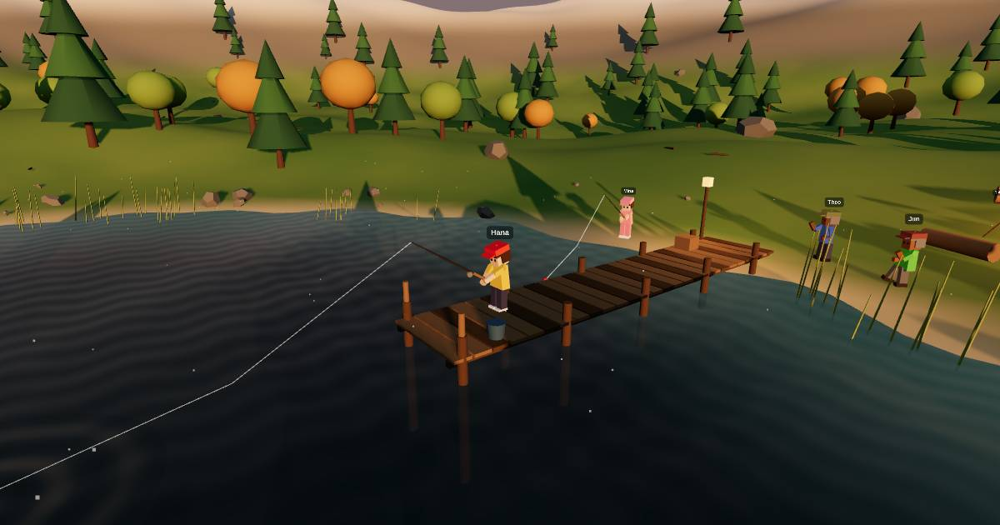

# Stillwater Lake



A quiet, shared 3D lakeside game. Walk around the lake, fish, gather branches and stones, build a campfire, grill your catch, and meet other visitors. It runs in a browser on desktop and mobile, with no signup required.

This project is completely open source. To try it with your own Skapi project, replace `SKAPI_PROJECT_ID` in `index.html` with your project ID.

## How it was built

The application is a single-page experience implemented in [`index.html`](./index.html), using inline HTML, CSS, and JavaScript. [Three.js](https://threejs.org/) renders the WebGL world; the game logic handles movement, fishing, gathering, cooking, and player interactions. The page loads Three.js and the Skapi JavaScript SDK from CDNs.

## Skapi features demonstrated

- **Anonymous authentication:** visitors receive temporary Skapi sessions and can join without creating an account.
- **Realtime groups:** players join the `stillwater-lake` group. Realtime messages share player state and events, including movement, fishing, campfires, grills, and other interactions, so participants see one another in the same lake.
- **Presence and reconnection:** join/leave notices update who is at the lake, and the app handles reconnecting or returning visitors whose temporary session has expired.

## Run locally

You can open `index.html` directly in a browser, or run the app with the included local server. To start the server:

```sh
npm install
npm run dev
```

Then visit [http://localhost:5173](http://localhost:5173).

The app uses a Skapi project ID configured in `index.html`; Skapi Realtime requires a network connection. If the initial connection fails, you can enter your own project ID when prompted. Create a project at [skapi.com](https://skapi.com) to get an ID; the replacement is saved in your browser.